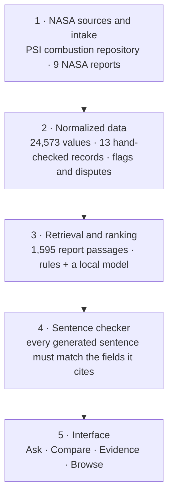

# How Flaregrain is built

Flaregrain answers plain-language questions about NASA's microgravity fire experiments. Every number it shows links to the NASA table or report page it came from. Our own readings and models are labelled apart from NASA evidence, and where two NASA sources disagree, both values stay visible.

Behind the pages is a five-layer system: NASA sources go in at the bottom, and every answer, comparison and explanation is traced back down through the layers to them.



## 1 · NASA sources and intake

- **NASA Physical Sciences Informatics (PSI) combustion repository:** 24 investigations and 2,009 experiment table rows.
  - By area: extinction 8 investigations (1,055 rows), flammability 7 (290), fundamentals 3 (76), detection 6 (588).
- **9 NASA technical reports** (NTRS), cited page by page.
- Intake scripts fetch the PSI records and tables from NASA and normalize them. Raw NASA tables are linked, not copied.
- **Licences:** the PSI records carry CC0-1.0, except PSI-10, whose licence field is blank. That's recorded as a data issue and disclosed rather than assumed.

## 2 · Normalized data, with its quality kept visible

- **24,573 normalized values**, each with its original unit and its table row.
- **575 flagged values:** places where NASA printed a value that reads as something else. The flag types are: percent printed 100× too large, spreadsheet auto-fill damage, missing decimal point, length and width swapped, a header that lost a subscript, a missing or wrong header unit, and implausible values flagged for checking. The printed value is kept and the flag says why. There are also 13 record-level issues, such as PSI-10's blank licence.
- **13 hand-checked NASA records:**
  - BASS-II B1, B10, B11 and M7
  - BASS GMT96-T7
  - Saffire I-1, I-2, II-5, II-6 and III-1
  - FLEX test 2
  - the SAME and SAME-R Kapton smoke baselines

  Every value carries its report page.
- **Four provenance tiers:** checked NASA record, PSI table row, Flaregrain model or reading, and context (not evidence). On top sit a **flag** state (NASA printed a value we read as something else) and a **dispute** state (two NASA sources disagree; both are shown).
  - Example: Saffire I-1's sample thickness reads 0.37 mm in the NASA report but sits under a "cm" column heading in the PSI table.
- **An overnight statistical sweep** proposed 861 candidate issues for a second reading. Questioned values get a second reading before they're published.
- **A separate cross-check** of table rows against the report text found both known Saffire II disputes on its own.

## 3 · Retrieval and ranking

- **1,595 report passages** chunked from the 9 NASA reports, so an answer can quote the exact page.
- **Investigation ranking** reads the question, picks the criteria it implies, and ranks the 24 investigations by rules. A small model running locally (qwen3:4b) can re-rank and explain, but the rules order stands whenever the model is silent or fails a check.
- **Evaluation:** 30 questions, each asked 4 ways (plain, technical, short, misspelled), so 120 wordings. The scores cover the 108 wordings that have an expected answer; the other 12 should get none.

| Wording | recall@5 | hit@1 |
|---|---|---|
| Plain | 0.826 | 0.852 |
| Technical | 0.817 | 0.815 |
| Short | 0.886 | 0.926 |
| Misspelled | 0.872 | 0.741 |
| **All, rules only** | **0.850** | **0.833** |

- **With the live model added**, an earlier overnight run on the Mac Mini measured hit@1 0.806 and recall@5 0.839. In that run, though, the model returned a reading for only 22 of the 120 wordings; the rest timed out or gave no criteria. So it isn't a full model-ranking result, and the rules-only scores above are the ones we stand behind.
- **A correction we made:** an earlier evaluation script counted hidden rows left over from the previous question. It inflated scores to 0.861–0.875. We found it, fixed it and re-measured; the numbers above are the corrected ones.

## 4 · Sentence checker

The model's explanations are never trusted on their own. Each sentence is kept only if every number and record it mentions matches the record fields it cites.

The checker removes a sentence that:
- uses a wrong number or unit
- names the wrong record
- adds a cause the sources don't state
- has no citation
- touches a disputed value

Removed sentences stay listed with the reason.

- **Saved explanations:** 139 record pairs among the 13 checked records, written by qwen3:4b (Ollama 0.40.16) on the team's own machine. **492 sentences passed the checker and 270 were removed.** Each is labelled "Flaregrain reading · not NASA evidence".
- **Stress test:** 343,758 synthetic test sentences over 55 record pairs.
  - There were 0 misses for wrong numbers, the other record's fact, cause words, no citation, and disputed values stated as fact.
  - Wrong-unit misses (counted per sentence framing) fell from 920 to 240 after two fixes.
  - It's a team run on the Mac Mini; its harness isn't yet in this repository.
  - **Known gap:** invented details that reuse words from the cited fields often pass. That's why model text is always labelled as Flaregrain's reading and never styled as NASA evidence.
- A live answer is accepted only for the exact pair it was asked about, and only if its facts fingerprint matches the records on the page. Otherwise the saved, checked explanation is shown.

## 5 · Interface

- **Ask** a question in plain words and get a cited answer with its limitation. For example, NASA gives no measured delay between airflow shutoff and extinction.
- **Compare** two experiments: what they share, how they differ, and what the sources leave open.
- **Evidence:** the exact NASA page behind each value.
- **Browse:** every checked record.
- Model text is always labelled as Flaregrain's reading, never styled as NASA evidence. Nothing needs a sign-in.

## What this public site carries

This site serves the **13 hand-checked NASA records** (11 comparable runs, 110 Compare pairs). The full dataset (all 24 investigations, 2,009 rows and the passage search) and the live model run in the team's demo. Those pages say so plainly.

## Check it yourself

```sh
python3 -I flaregrain/tests/run.py       # build and data checks
python3 -I flaregrain/build.py --check   # builds the site into a temporary folder and checks it
```

## How it was made

The intake, data checks, model wiring and pages were written by the Sparkline Foundry team with AI coding assistants (Claude Code and Codex), and the team reviewed the changes. The saved explanations were generated by qwen3:4b and filtered by the checker. The data and records were compiled from public NASA sources, partly before the event; every value links to its source.
